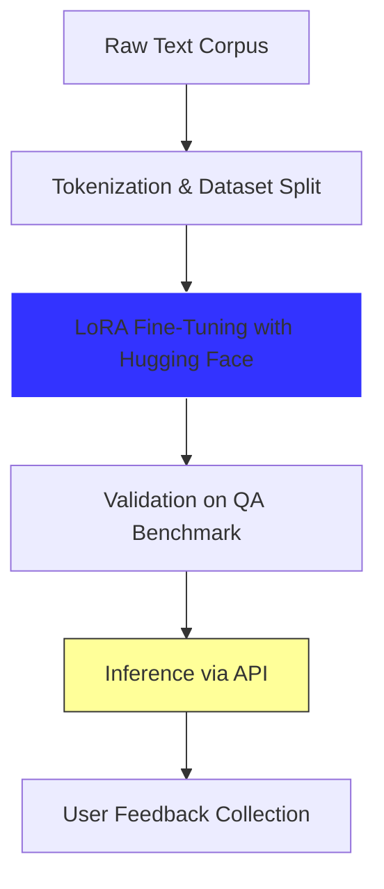

# Fine-Tuning LLMs on Domain-Specific Datasets

- **Objective**: Improve performance of LLMs on business, economic, finance, marketing texts separately
- **Dataset**: Custom domain corpus (e.g., marketing reports, legal contracts)  
- **Method**: LoRA (Low-Rank Adaptation) with gradient checkpointing  
- **Planned Result**: 12% improvement in factual accuracy on a QA benchmark  
- **Tools**: Hugging Face Transformers, PEFT, Accelerate

## LLM Fine-Tuning Pipeline



## Example after LLM Fine-Tuning: Domain-Specific Text Summarizer (NLP)

- **Purpose**: Generate concise summaries from long documents  
- **Model**: Fine-Tuned LLM
- **Input**: Text file or JSON  
- **Output**: Summary (50–100 words)  
- **Usage**:
  ```bash
  python summarize.py --input docs/marketing_report.txt --output summary.md
  ```